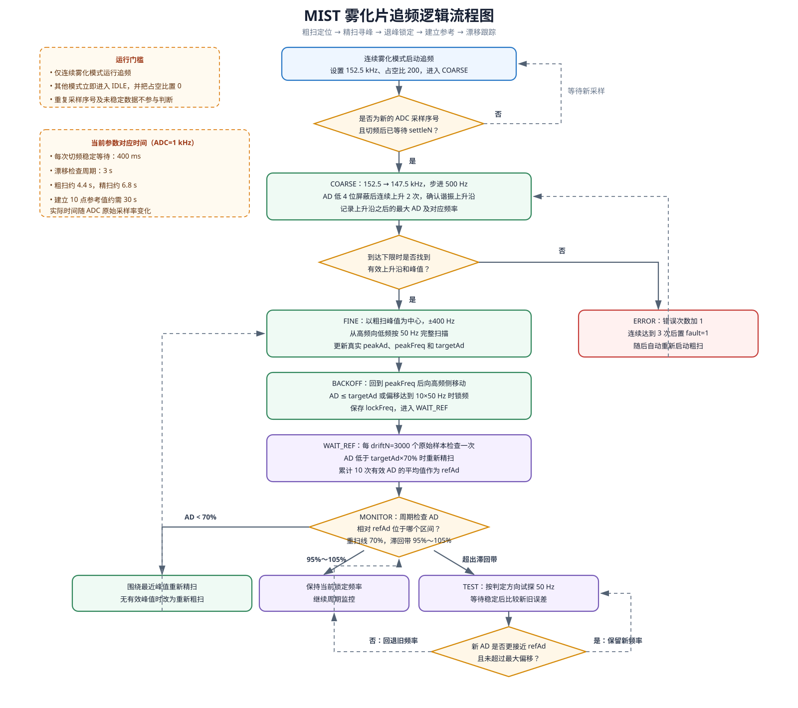

# 手持风扇 Gen2 MIST 雾化片追频方法说明

| 项目 | 内容 |
| --- | --- |
| 文档对象 | BA_handheld_Fan_Gen2 雾化片自动追频模块 |
| 依据代码 | `mist_ctrl.c/.h`、`mist_process.c/.h`、`app_mist.c`、`app_sampling.c`、`filter.c` |
| 适用版本 | 代码库当前实现（2026-11-04） |
| 算法形式 | 非阻塞状态机：粗扫、精扫、退峰锁定、参考建立和漂移跟踪 |

## 1. 目的与总体结论

压电雾化片的谐振频率会随器件离散性、液位、温度、装配预紧力及老化发生变化。固定频率驱动可能偏离最佳工作点，造成雾量下降、功耗升高或工作不稳定。

当前软件通过改变 PWM 频率并观测雾化反馈 ADC（下文简称 AD）来寻找响应峰值。算法先在 147.5～152.5 kHz 范围粗扫，再在粗略峰值附近精扫，锁定工作频率；运行中以参考 AD 为目标，通过周期监控和单步试探跟踪频率漂移。整个过程由 ADC 原始采样序号驱动，不在任务内阻塞等待。

## 2. 输入、输出和运行接口

### 2.1 输入

- `ad`：雾化片反馈通道的滤波 ADC 值，来自 `ADC_CH_WH`。
- `seq`：该通道 ADC 原始采样累计序号，每产生一次原始样本加 1。
- `mist_cfg_t`：扫描范围、步长、稳定等待、阈值和默认占空比等参数。

ADC 反馈采用长度为 10 的滑动窗口，去除一个最大值和一个最小值后，对其余 8 点取平均。滤波窗口会随每个原始样本滑动。

### 2.2 输出

- `setFreq(freq)`：更新目标 PWM 频率；应用层最终调用 TIM16 配置硬件。
- `setDuty(duty)`：更新目标 PWM 占空比。
- 状态输出：当前状态、工作频率、峰值频率、锁频频率、峰值 AD、目标 AD、参考 AD、锁定标志、重扫次数和故障标志。

### 2.3 启停条件

追频仅在 `MIST_MODE_CONTINUE` 连续雾化模式运行。进入连续模式后，应用启动追频；脉冲模式或关闭模式会停止追频、进入 `IDLE` 并把追频输出占空比设为 0。

## 3. 逻辑框架与流程图

主状态转换关系如下：

| 状态 | 主要任务 | 正常去向 | 异常/重扫去向 |
| --- | --- | --- | --- |
| `IDLE` | 停止追频 | 启动后进入 `COARSE` | — |
| `COARSE` | 全范围粗扫，识别上升沿和粗略峰值 | `FINE` | 未找到有效峰值进入 `ERROR` |
| `FINE` | 峰值附近小步进扫描，确定真实峰值 | `BACKOFF` | 峰值无效进入 `ERROR` |
| `BACKOFF` | 从峰值向高频侧寻找目标工作点 | `WAIT_REF` | 达到最大偏移也会锁定 |
| `WAIT_REF` | 周期采样并建立稳定参考 AD | `MONITOR` | AD 过低时重新精扫 |
| `MONITOR` | 判断反馈是否位于参考滞回带 | 保持或进入 `TEST` | AD 过低时重新精扫 |
| `TEST` | 单步调整频率并比较修正前后误差 | `MONITOR` | 无改善则撤销调整 |
| `ERROR` | 累计错误并自动重启扫描 | `COARSE` | 连续 3 次错误置故障位 |

## 4. 采样门控与切频稳定等待

`mist_ctrl_task()` 只有同时满足以下条件才处理一次数据：

1. 控制器已初始化；
2. 当前状态不是 `IDLE`；
3. `seq` 与上次处理的序号不同；
4. 距离最近一次切频至少经过 `settleN` 个原始 ADC 样本。

稳定条件为：

$$
seq-seq_{switch} \ge N_{settle}
$$

当前 `settleN = 400`。ADC 由 TIM3 以 1000 Hz 触发，因此正常情况下每次切频等待约 400 ms。算法使用无符号差值，可兼容 32 位序号自然回绕。

该等待非常关键：PWM 频率改变后，驱动电路、雾化片机械振动和滑动平均窗口都需要时间更新；过早读取 AD 会把旧频率的残留响应归到新频率。

## 5. 各阶段方法

### 5.1 粗扫：定位谐振区域

启动后设置频率为 152.5 kHz，按 500 Hz 步进向下扫描至 147.5 kHz。每次切频后等待稳定，再读取一次滤波 AD。

为降低小幅噪声造成的误判，比较上升趋势时屏蔽 AD 低 4 位：

$$
AD_{mask}=AD\ \&\ 0xFFF0
$$

连续上升达到 `riseCnt = 2` 次后确认已进入谐振上升沿；之后记录扫描中的最大 AD 和对应频率。只有在扫描结束时同时存在上升沿和非零峰值，才进入精扫，否则进入错误状态。

### 5.2 精扫：确定真实峰值

以粗扫峰值 `peakFreq` 为中心建立精扫窗口：

$$
f_{start}=f_{peak}+fineStep\times fineN
$$

$$
f_{end}=f_{peak}-fineStep\times fineN
$$
当前 `fineStep = 50 Hz`、`fineN = 8`，理论窗口为粗扫峰值上下各 400 Hz，共 17 个频率点。算法从高频端向低频端完整扫描，并保存窗口内最大 AD 及频率作为真实峰值。

目标 AD 计算为：

$$
AD_{target}=AD_{peak}\times\frac{targetPct}{100}
$$

当前 `targetPct = 100%`，因此目标 AD 等于峰值 AD。

### 5.3 退峰与锁频

精扫完成后先回到 `peakFreq`，随后按 50 Hz 向高频侧移动。当满足以下任一条件时锁定：

- 当前 `AD ≤ targetAd`；
- 工作频率与峰值频率的偏差达到 `backoffN × fineStep = 500 Hz`。

锁定后保存 `lockFreq` 和当前 AD，置位 `locked`，进入参考值建立阶段。

需要注意：当前 `targetPct = 100%`，回到峰值后的第一次测量通常已经满足 `AD ≤ peakAd`，因此正常情况下会直接锁在峰值附近，退峰过程可能不会真正向高频侧移动。如果设计目标是锁在峰值高频侧、以降低器件应力或提供漂移方向，应通过实测将 `targetPct` 调整到小于 100% 的合适值。

### 5.4 建立漂移参考值

锁频后，每经过 `driftN = 3000` 个原始样本检查一次，正常对应 3 s：

- 若 `AD < targetAd × 70%`，认为响应严重下降，立即围绕最近峰值重新精扫；
- 否则累计本次 AD；累计 `lockCnt = 10` 次后取平均，得到 `refAd`。

$$
AD_{ref}=\frac{\sum_{i=1}^{10}AD_i}{10}
$$

在 1 kHz ADC 采样率下，建立参考值约需 30 s。

### 5.5 漂移监控

进入 `MONITOR` 后仍每 3 s 检查一次。阈值由参考 AD 计算：

$$
AD_{low}=AD_{ref}\times95\%,\quad
AD_{high}=AD_{ref}\times105\%
$$

$$
AD_{rescan}=AD_{ref}\times70\%
$$

- `AD < ADrescan`：响应严重下降，重新精扫；
- `ADlow ≤ AD ≤ ADhigh`：保持当前频率；
- AD 超出 95%～105% 滞回带：进入单步试探。

### 5.6 单步漂移试探

监控值偏高时先升频 50 Hz，偏低时先降频 50 Hz。等待稳定后分别计算调整前后的参考误差：

$$
E_{old}=|AD_{old}-AD_{ref}|,
\quad E_{new}=|AD_{new}-AD_{ref}|
$$

只有 `Enew < Eold` 且频率未偏离峰值超过 500 Hz 时，才保留新频率；否则回退到旧频率。之后回到 `MONITOR`。

该方向判断建立在工作点位于谐振峰值高频侧、局部 AD-频率关系单调的假设上。若锁在峰顶或低频侧，仅试探一个预设方向可能无法找到改善方向，因此 `targetPct` 和退峰效果必须结合实测验证。

### 5.7 错误与恢复

粗扫未找到有效峰值、精扫峰值为零或出现未知状态时进入 `ERROR`。每进入一次错误处理就增加 `errCnt`；达到 `faultCnt = 3` 后置 `fault = 1`，随后仍自动重新开始粗扫。一次精扫成功后会清除 `fault` 和 `errCnt`。

该故障位属于算法状态指示，当前追频模块不会因故障自动永久关闭 PWM，也不包含过流、过温或干烧保护；这些安全功能必须由外部模块承担。

## 6. 当前参数与时间尺度

| 参数 | 当前值 | 含义 | 在 ADC=1 kHz 时的效果 |
| --- | ---: | --- | --- |
| `centerFreq` | 150000 Hz | 标称中心频率 | 初始状态记录值 |
| `minFreq` / `maxFreq` | 147500 / 152500 Hz | 粗扫边界 | 5 kHz 总范围 |
| `coarseStep` | 500 Hz | 粗扫步进 | 共 11 个频率点 |
| `fineStep` | 50 Hz | 精扫/漂移步进 | 细分辨率 50 Hz |
| `settleN` | 400 | 切频稳定样本数 | 每步约等待 400 ms |
| `fineN` | 8 | 精扫半区步数 | 峰值两侧各 400 Hz |
| `driftN` | 3000 | 漂移检查间隔 | 每 3 s 检查一次 |
| `lockCnt` | 10 | 参考值累计次数 | 建立参考约 30 s |
| `targetPct` | 100% | 退峰目标占峰值比例 | 通常直接锁在峰值附近 |
| `rescanPct` | 70% | 重新精扫门限 | AD 严重衰减时重扫 |
| `driftLo` / `driftHi` | 95% / 105% | 监控滞回带 | 参考值上下 ±5% |
| `backoffN` | 10 | 最大退峰步数 | 最大偏离峰值 500 Hz |
| `faultCnt` | 3 | 故障确认次数 | 连续 3 次失败置故障 |
| `duty` | 200 | 扫描默认占空比 | 单位由 TIM16 驱动约定 |

在不发生边界裁剪和重扫的理想情况下：粗扫约 11×0.4 = 4.4 s，精扫约 17×0.4 = 6.8 s，退峰最多约 4 s；随后建立漂移参考约 30 s。首次达到完整监控状态通常需要约 41～45 s。实际时间还受应用任务调度、ADC 数据更新和频率边界影响。

## 7. 应用条件

| 类别 | 必要条件 |
| --- | --- |
| 反馈特性 | AD 必须能够反映雾化片响应幅值，并在扫描范围内形成可识别的单一主峰 |
| 频率范围 | 实际谐振频率在 147.5～152.5 kHz 内，包含温度、液位、装配和老化漂移余量 |
| PWM 能力 | TIM16 能稳定输出目标频率和占空比，50 Hz 步进对应的实际误差满足要求 |
| ADC 采样 | 原始采样持续、序号单调递增；当前时间参数依赖 1 kHz 采样率 |
| 采样链路 | 反馈通道不饱和、不贴近零点，噪声和 PWM 串扰不淹没谐振趋势 |
| 稳定时间 | 400 ms 足够覆盖硬件响应和 10 点滑动滤波窗口更新；改变硬件后需重新验证 |
| 工况稳定 | 一轮粗扫/精扫期间液位、电源、温度和机械负载不能发生剧烈变化 |
| 工作模式 | 只在连续雾化模式运行；脉冲模式的开关过程不适用于该追频方法 |
| 安全保护 | 过流、过温、缺水/干烧及驱动异常必须由外部保护逻辑处理 |
| 参数标定 | 扫频范围、目标比例、重扫门限、滞回带、占空比均需用量产雾化片与整机实测标定 |

## 8. 当前实现注意事项

1. **启动序号固定为 0**：`app_mist_start()` 调用 `mist_ctrl_start(&mist_ctrl, 0)`，而系统运行一段时间后实际 ADC 序号通常已大于 400。此时首次任务可能立即通过稳定等待，且 PWM 硬件刚在本周期末更新，导致 152.5 kHz 的首个采样点混入旧频率数据。建议启动时传入当前 `get_mist_seq()`。
2. **目标比例为 100%**：使退峰状态通常在峰值点立即锁定，与“向高频侧退峰”的设计描述不完全一致；同时弱化了漂移方向判断的单调性前提。
3. **参数合法性检查不完整**：初始化未校验 `settleN`、`driftN`、`lockCnt`、`backoffN`、`rescanPct` 和漂移上下限之间的关系。错误配置可能造成无等待、持续试探或异常重扫。
4. **PWM 设置为异步落地**：算法回调只更新 `System.logic`，硬件频率在 `app_mist_1ms_task()` 末尾才配置。稳定计数起点应与硬件实际切频时刻尽量一致。
5. **故障后继续驱动和重扫**：`fault=1` 只用于状态提示，不会停止占空比。若连续扫描失败代表缺水或硬件故障，应由应用层决定是否停机。
6. **反馈有效性未显式判断**：算法只以零峰值和相对阈值判断异常，没有 ADC 饱和、断线、短路或绝对最小响应门限。

## 9. 建议验证项目

1. **频响曲线测试**：在不同液位、温度、电压和雾化片批次下，以 50 Hz 或更细步进测量完整 AD-频率曲线。
2. **扫频重复性**：同一工况重复启动至少 30 次，统计 `peakFreq`、`peakAd`、`lockFreq` 和雾量离散度。
3. **稳定等待验证**：示波器同步观察 PWM 频率切换和反馈包络，确认 400 ms 后数据已稳定。
4. **退峰参数标定**：比较 `targetPct` 为 90%～100% 时的雾量、功耗、温升、噪声和漂移可跟踪性。
5. **漂移测试**：缓慢改变液位和温度，确认单步试探方向正确、不会来回振荡，且频率不超过允许偏移。
6. **突变与重扫测试**：快速加水、移走液体或更换负载，验证 70% 门限能可靠触发精扫或粗扫。
7. **异常反馈测试**：模拟 ADC 为 0、满量程、强噪声和断续采样，验证故障计数与应用停机策略。
8. **启动序号测试**：设备长时间运行后再进入连续模式，确认首个扫描点确实经过完整稳定等待。
9. **边界样品测试**：使用谐振点接近 147.5 kHz 和 152.5 kHz 的样品，验证窗口裁剪后仍能可靠锁频。

## 10. 结论

当前方法具备完整的自动寻峰和慢速漂移跟踪框架，适合谐振峰清晰、工况变化相对缓慢的连续雾化系统。量产应用前，应优先修正启动采样序号，明确退峰目标比例和高频侧工作点，再通过实际雾化片频响、温升和寿命数据完成参数标定；安全保护不能只依赖本追频状态机。
