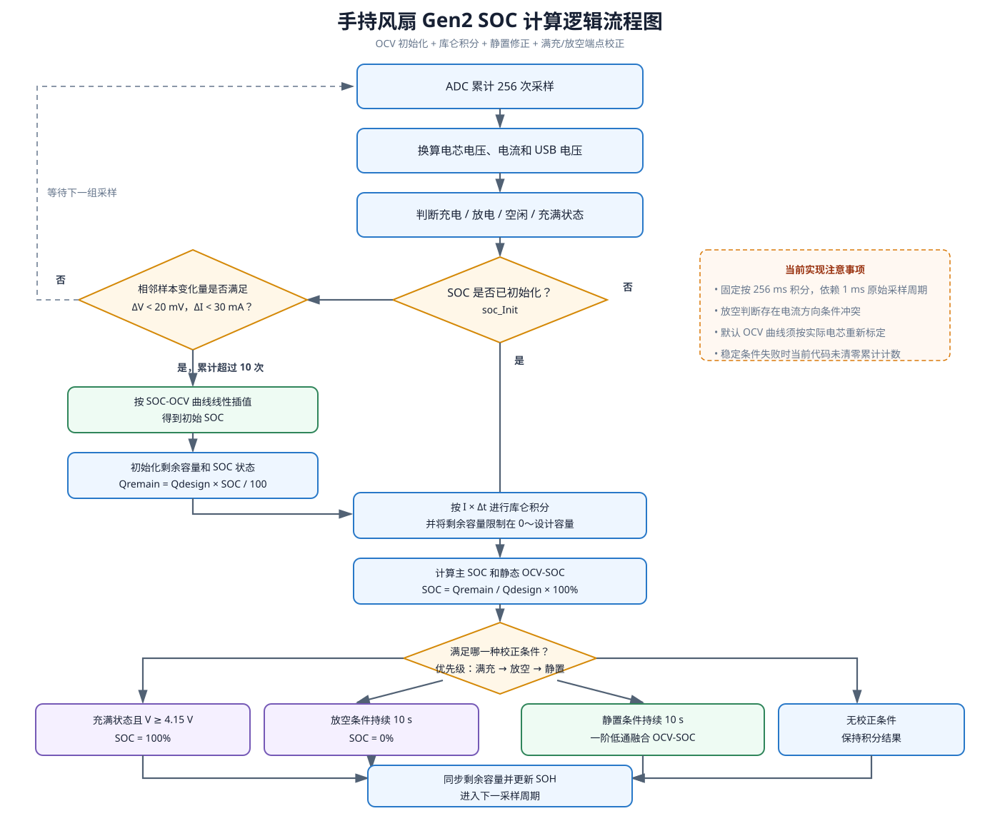
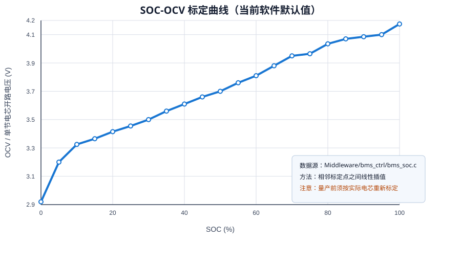

# 手持风扇 Gen2 电量（SOC）计算方法说明

| 项目 | 内容 |
| --- | --- |
| 文档对象 | BA_handheld_Fan_Gen2 电池管理软件 |
| 依据代码 | `Application/app_bms.c`、`Middleware/bms_ctrl/bms_soc.c`、`bms_config.h`、`bms_convert.c` |
| 适用版本 | 代码库当前实现（2026-11-04） |
| 术语说明 | 本文采用行业通用名称 **SOC-OCV**；需求中的 “SOC-COV” 按 “SOC-OCV（开路电压）” 理解 |

## 1. 目的和结论

本项目不是只用电压或只用电流计算电量，而是采用组合估算：

1. 上电阶段在采样相对稳定后，根据 OCV 曲线得到初始 SOC；
2. 运行阶段按电流和时间进行库仑积分，得到连续变化的主 SOC；
3. 满足静置条件时，用 OCV 参考 SOC 对积分误差进行缓慢校正；
4. 充满和放空条件被可靠确认后，将 SOC 校正到 100% 或 0%；
5. 同时维护剩余容量、累计充入量、累计放出量，供显示、SOH 和掉电存储使用。

该方法适用于具有可用电流采样、单节电芯电压采样和充满状态反馈的产品。OCV 曲线、电池容量、电流零点与增益、充放电效率都必须按实际电芯和硬件标定，不能把当前默认值直接视为量产参数。

## 2. 术语和输出量

- **SOC（State of Charge）**：剩余电量占可用容量的百分比，范围 0%～100%。
- **OCV（Open Circuit Voltage）**：电芯充分静置后的开路电压。需求中的 COV 在本文中按 OCV 处理。
- **主 SOC**：`soc_info.soc`，供产品电量显示和控制使用，来源是库仑积分并接受 OCV/端点校正。
- **静态 SOC**：`soc_info.static_soc`，直接由当前电压查 SOC-OCV 表得到。代码每次更新都会计算它，但只有满足静置条件后才用于修正主 SOC。
- **剩余容量**：`remaining_capacity_mah`，单位 mAh，与主 SOC 保持一致。

## 3. 逻辑框架

处理入口为 `app_bms_1ms_task()`。仅当 `sample_accum_get()` 取得一组完整的 ADC 平均值时，才执行电压、电流、状态、保护和 SOC 更新。

## 4. 上电初始化

### 4.1 当前执行条件

`app_bms_soc_update()` 在 `soc_Init == false` 时比较相邻两组采样：

$$
|V_k-V_{k-1}| < 0.02\text{ V}
$$

$$
|I_k-I_{k-1}| < 30\text{ mA}
$$

条件累计超过 10 次后，使用当前端电压调用 `bms_soc_from_ocv()`，再用该结果初始化 SOC 和剩余容量：

$$
Q_{remain}=Q_{design}\times \frac{SOC_{init}}{100}
$$

当前设计容量为 5000 mAh。

### 4.2 使用限制

上述判断只证明相邻采样变化较小，并不等价于电芯已经充分静置。若设备上电时仍带负载或正在充电，端电压包含内阻压降和极化电压，OCV 初值会有偏差。因此，理想应用条件是上电初始化期间负载足够小，并经过与电芯特性匹配的静置时间。

当前代码在条件不满足时没有清零 `Cnt`，所以实际行为是“累计满足超过 10 次”，并非注释所写的“连续超过 10 次”。若设计要求连续稳定，应在条件失败分支清零计数。

## 5. 运行阶段库仑积分

### 5.1 单周期电量

每次更新的原始电量增量为：

$$
\Delta Q=\frac{|I|\times \Delta t}{3\,600\,000}\quad(\text{mAh})
$$

其中电流单位为 mA，时间单位为 ms。当前调用传入 `SAMPLE_ACCUM_COUNT = 256 ms`。

### 5.2 当前代码采用的电流方向

以实际分支和状态判断为准：

- `current_ma > 0`：按充电处理；
- `current_ma < 0`：按放电处理；
- `current_ma == 0`：剩余容量不变。

充电：
$$
Q_{remain,new}=Q_{remain,old}+\Delta Q\times \eta_{chg}
$$

放电：
$$
Q_{remain,new}=Q_{remain,old}-\frac{\Delta Q}{\eta_{dsg}}
$$

之后限制 `Qremain` 在 0～`Qdesign`，再换算 SOC：
$$
SOC=\frac{Q_{remain}}{Q_{design}}\times 100\%
$$

当前配置为 `ηchg = 3.35`、`ηdsg = 1.00`。其中 3.35 明显更像整机电流测量/换算补偿系数，而不是通常意义上不大于 1 的电芯库仑效率，应通过充电实测确认其物理含义并重新命名或标定。

### 5.3 时间基准条件

传给 `bms_soc_update()` 的是固定 256 ms，而非实测时间。因此该计算成立的前提是：ADC 原始采样周期确实为 1 ms、每 256 点产生一次数据且没有丢组或延迟。如果实际采样周期改变，应传入真实经过时间；单次间隔超过 1000 ms 时当前算法会拒绝更新。

## 6. SOC-OCV（需求所称 SOC-COV）曲线

当前软件采用 21 个点，点间使用线性插值；低于 2.920 V 返回 0%，高于 4.175 V 返回 100%。

| SOC (%) | OCV (V) | SOC (%) | OCV (V) | SOC (%) | OCV (V) |
| ---: | ---: | ---: | ---: | ---: | ---: |
| 0 | 2.920 | 35 | 3.560 | 70 | 3.950 |
| 5 | 3.200 | 40 | 3.610 | 75 | 3.965 |
| 10 | 3.325 | 45 | 3.660 | 80 | 4.035 |
| 15 | 3.365 | 50 | 3.700 | 85 | 4.070 |
| 20 | 3.415 | 55 | 3.760 | 90 | 4.085 |
| 25 | 3.455 | 60 | 3.810 | 95 | 4.100 |
| 30 | 3.500 | 65 | 3.880 | 100 | 4.175 |

插值公式为：当 `V_i ≤ V < V_{i+1}` 时，

$$
SOC(V)=SOC_i+\frac{V-V_i}{V_{i+1}-V_i}(SOC_{i+1}-SOC_i)
$$

该曲线是软件默认参考曲线。OCV 与电芯化学体系、温度、老化程度、静置时间和充放电历史有关，量产前应基于所选电芯实测数据，在目标温区分别评估或建立温度补偿曲线。

## 7. 静置 OCV 柔性校正

运行中同时满足以下条件才累计静置时间：

1. `|I| ≤ 50 mA`；
2. 电压变化率不超过 0.02 V/s；
3. 条件持续至少 10 s。

达到条件后，不直接把主 SOC 跳变为 OCV-SOC，而是按一阶低通逐次融合：

$$
\alpha=\frac{\Delta t}{\tau+\Delta t},\qquad
SOC_{new}=SOC_{old}+\alpha(SOC_{OCV}-SOC_{old})
$$

其中 `τ = 600000 ms`。按当前 `Δt = 256 ms`，单次修正系数约为 0.000426，即校正过程较慢，可抑制显示跳变。10 s 静置阈值对于锂电芯可能不足以达到真正热力学稳定，只适合当前产品的快速工程修正，需通过整机试验确定。

## 8. 满充和放空端点校正

### 8.1 满充

同时满足以下条件时强制校正为 100%：

- IP5326 状态识别为 `BAT_STATE_FULL`；
- 电芯电压不低于 4.15 V。

不能只凭电压达到 4.15 V 判断充满，因为充电中的端电压受电流和极化影响。

### 8.2 放空

设计意图是：处于放电状态、存在明显放电电流、端电压不高于 3.00 V，并持续 10 s 后，将 SOC 和剩余容量校正为 0。

但当前实现存在方向条件冲突：状态函数把负电流判为放电，而放空分支又要求 `current_ma > 50 mA`，两者无法同时成立，因此放空端点校正按当前代码不会触发。应在确认硬件电流极性后统一 `bms_battery_current()`、`bms_battery_state()`、SOC 积分和端点判断的符号约定。

## 9. 掉电保存与恢复

软件提供 `app_bms_Save()`/`app_bms_Restore()`，保存对象包括 SOC、静态 SOC、SOH、剩余容量及累计充放电量。当前应用初始化流程虽然先读取 Flash，但随后仍将 `soc_Init` 置为 false，并最终用 OCV 结果重新初始化剩余容量；因此恢复的 SOC/剩余容量没有真正作为启动初值使用。保存动作目前也只由调试标志 `Is_bms_save` 触发。

若产品要求掉电续算，应补充：数据有效性和版本校验、SOC 与剩余容量一致性检查、周期/事件触发保存策略，以及“有效历史值优先、静置 OCV 后再柔性纠偏”的启动策略。还需控制 Flash 写入频率，避免寿命问题。

## 10. 应用条件

本算法投入使用前至少应满足下列条件：

| 类别 | 必要条件 |
| --- | --- |
| 电芯 | 单节锂电；容量、满充/截止电压和 SOC-OCV 数据与实际料号一致 |
| 电压采样 | 电压换算经过实测校准，误差满足 SOC 分辨率要求 |
| 电流采样 | 零点、增益、温漂和正负方向经过充放电双向验证 |
| 时间基准 | SOC 更新使用真实采样间隔；任务延迟或丢样时不得继续假设固定 256 ms |
| OCV 使用 | 仅在小电流且电压稳定时用于初始化或修正，不把带载端电压直接当作 OCV |
| 满充信号 | IP5326 的 FULL 状态识别可靠，并与 4.15 V 门限共同确认 |
| 参数标定 | 5000 mAh 容量、3.35/1.00 系数、50 mA、10 s、600 s 等参数均完成整机验证 |
| 温度与老化 | 明确允许温区；低温、高温及老化电芯需验证 OCV 偏差和有效容量变化 |
| 持久化 | 需要跨掉电连续显示时，必须完成有效性校验、保存时机和 Flash 寿命设计 |

## 11. 建议验证项目和验收指标

1. **电流方向测试**：分别充电和放电，确认电流符号、状态枚举、SOC 增减方向及累计量一致。
2. **容量标定测试**：用标准电流计/电子负载完成至少三次完整循环，拟合电流增益和效率参数。
3. **OCV 标定测试**：按目标温度点分段放电，每个 SOC 点充分静置后记录 OCV，替换默认曲线。
4. **静置回归测试**：制造 10%、30%、50%、80% SOC 积分偏差，验证静置校正方向、速度和无突跳性。
5. **端点测试**：验证 FULL+4.15 V 可校正 100%，修正方向冲突后验证 3.00 V 持续 10 s 可校正 0%。
6. **时间基准测试**：模拟任务抖动、采样丢组和超过 1 s 的间隔，确认不会多算或漏算电量。
7. **掉电恢复测试**：在不同 SOC 掉电重启，验证历史值、OCV 初值及 Flash 有效性策略。
8. **误差指标建议**：在额定温区和典型负载下，完整循环 SOC 误差目标先设为 ±5%，再根据产品要求和标定结果收紧。

## 12. 当前实现风险清单

| 优先级 | 项目 | 影响 |
| --- | --- | --- |
| 高 | 电流方向注释、状态和放空条件不统一 | 放空 0% 端点无法触发，维护时易引入反向积分 |
| 高 | 固定以 256 ms 作为积分时间 | 原始采样并非严格 1 ms 或发生丢样时产生累计误差 |
| 高 | 默认 OCV 曲线未声明为实测电芯曲线 | 初值和静置修正可能产生系统偏差 |
| 中 | 上电稳定计数失败时不清零 | 非连续稳定样本也可能触发 OCV 初始化 |
| 中 | 充电效率 3.35 的物理意义不明确 | 参数迁移或硬件变更后可能造成严重估算偏差 |
| 中 | Flash 恢复值未用于 SOC 初始化 | 重启后电量可能按带载电压重新估算并跳变 |
| 中 | 静置门限仅 10 s | 端电压可能尚未充分松弛，OCV-SOC 仍有偏差 |

---

本文描述的是当前代码的实际计算路径，同时标出了与注释或设计意图不一致之处；在高优先级问题关闭并完成电芯标定前，不建议将默认参数作为量产定版参数。
